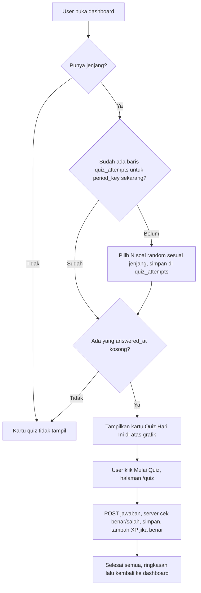

# Rencana Implementasi: Quiz Harian, XP, Quiz Setting & Log Jawaban

Dokumen ini adalah panduan langkah-demi-langkah untuk **Junior Programmer atau AI model yang lebih murah**.
Ikuti urutan tahap. Setiap tahap punya: tujuan, file yang disentuh, kode, dan **cek hasil** sebelum lanjut.

> Prasyarat (sudah ada di repo): kolom `users.jenjang`, modal isi jenjang untuk role `basic`, tabel `quizzes` + modul **Modul Quiz** di superadmin.
> Dokumen `issue.md` versi lama (Modul Quiz) sudah selesai diimplementasi dan digantikan oleh dokumen ini.

---

## 1. Ringkasan Fitur (pemetaan ke permintaan)

| # | Permintaan | Diselesaikan di |
|---|-----------|-----------------|
| 1 | Quiz hari ini tampil **di atas grafik** dashboard user | Tahap 6 |
| 2 | Tiap user dapat soal **random**, tiap user bisa beda | Tahap 2 |
| 3 | Soal disesuaikan dengan `users.jenjang` = `quizzes.jenjang` | Tahap 2 |
| 4 | Jawaban user **disimpan di tabel** | Tahap 1, 5 |
| 5 | User yang sudah menjawab hari itu **tidak bisa menjawab lagi** | Tahap 2, 5 |
| 6 | Superadmin bisa set **jam reset** quiz | Tahap 3 |
| 7 | **Tabel XP**, jawaban benar dapat XP sesuai setting | Tahap 1, 2 |
| 8 | Menu baru **Quiz Setting**: jam reset, jumlah soal/hari, XP per jawaban benar | Tahap 3 |
| 9 | Di menu Quiz Setting ada **Log** jawaban user + hasilnya bisa dicek | Tahap 4 |
| 10 | Sisi user hanya menampilkan quiz yang **harus dikerjakan** di atas grafik | Tahap 6 |
| 11 | Halaman mengerjakan quiz **beda dari sesi ujian**, interaktif & banyak animasi | Tahap 7 |

---

## 2. Keputusan Desain (WAJIB dibaca, jangan diubah tanpa tanya)

1. **Tidak pakai cron / Laravel Scheduler.** Di docker project ini tidak ada container scheduler (hanya `app`, `queue`, `mysql`, `redis`).
   "Reset" diimplementasi sebagai **periode quiz** yang dihitung dari jam reset:
   - Jam reset `08:00`. Sekarang `07:59` → periode = **kemarin**. Sekarang `08:01` → periode = **hari ini**.
   - Jam reset `00:00` (default) sama dengan ganti hari biasa.
   - Setiap baris jawaban menyimpan `period_key` (tanggal awal periode, format `Y-m-d`). Ganti periode = otomatis dianggap quiz baru. Tidak ada job yang perlu dijalankan.
2. **Soal di-assign sekali per periode** lalu disimpan di `quiz_attempts` (baris dengan `answered_at = NULL` artinya belum dijawab).
   Refresh halaman / pindah device tidak mengacak ulang soal.
3. **Soal di-assign saat user pertama kali membuka dashboard** pada periode itu (lazy). Hanya jika user punya `jenjang`.
4. **Prioritas soal yang belum pernah dikerjakan user.** Kalau sudah habis, boleh mengulang soal lama.
5. **XP hanya jika jawaban benar penuh** (all-or-nothing, termasuk `multiple_choice` & `multiple_benar_salah`). Besar XP = `quiz_settings.xp_per_correct` **saat user menjawab**.
6. **Kunci jawaban & pembahasan TIDAK BOLEH dikirim ke browser sebelum user menjawab.** Pengecekan benar/salah 100% di server.
7. **Dashboard user hanya menampilkan kartu jika masih ada quiz belum dikerjakan.** Kalau semua sudah dijawab / user belum punya jenjang / tidak ada soal untuk jenjangnya → kartu **tidak muncul** (sesuai permintaan "hanya menampilkan quiz yang harus dikerjakan").
8. Level/leaderboard **di luar scope** (hanya tabel total XP + tampil total XP di halaman quiz).
9. Mengubah jam reset di tengah hari bisa menggeser periode. Tampilkan peringatan di form (lihat Tahap 3).

### Alur harian



---

## 3. Aturan Umum

- **Jalankan semua perintah artisan di docker** (PHP lokal tidak punya ext Redis):
  ```bash
  docker exec -it irt_quiz_app_dev php artisan <perintah>
  ```
- Model di project ini memakai attribute `#[Fillable([...])]` (lihat `app/Models/Quiz.php` dan `app/Models/User.php`). Ikuti gaya yang sama.
- Timezone aplikasi sudah `Asia/Jakarta` (`config/app.php`). Pakai `now()`.
- Setelah mengubah Blade: `docker exec -it irt_quiz_app_dev php artisan view:clear`.
- **Aturan UI halaman superadmin** (feedback user sebelumnya, jangan dilanggar):
  1. Tombol-tombol aksi **satu baris (linear)** memakai `display:flex; gap:8px; flex-wrap:wrap`.
  2. Semua tombol `<a class="btn-primary">` wajib `text-decoration: none;` (**tanpa garis bawah**).
  3. Form filter **memenuhi lebar card** (`width:100%`, input `flex:1`), tombol **Reset** (merah, `#ef4444`) hanya muncul jika ada filter aktif, dan layout tetap fleksibel saat Reset muncul.
  4. Contoh acuan visual: `resources/views/admin/quizzes/index.blade.php`. Salin pola card, tabel, dan blok `<style>` pagination dari file itu.
- Jangan ubah modul Bank Soal / Modul Quiz / sesi ujian yang sudah ada.

---

## Tahap 1: Database (3 migration + 3 model)

**Tujuan:** menyimpan setting, jawaban harian, dan total XP.

### 1.1 Buat migration & model

```bash
docker exec -it irt_quiz_app_dev php artisan make:migration create_quiz_settings_table
docker exec -it irt_quiz_app_dev php artisan make:migration create_quiz_attempts_table
docker exec -it irt_quiz_app_dev php artisan make:migration create_user_xps_table
docker exec -it irt_quiz_app_dev php artisan make:model QuizSetting
docker exec -it irt_quiz_app_dev php artisan make:model QuizAttempt
docker exec -it irt_quiz_app_dev php artisan make:model UserXp
```

> Urutan penting: `quiz_attempts` memakai FK ke `quizzes` (sudah ada) dan `users`. Pastikan timestamp migration ketiganya **lebih baru** dari `2026_10_10_235447_create_quizzes_table.php`.

### 1.2 Isi migration `create_quiz_settings_table`

```php
use Illuminate\Support\Facades\DB;

public function up(): void
{
    Schema::create('quiz_settings', function (Blueprint $table) {
        $table->id();
        $table->string('reset_time', 5)->default('00:00');          // format H:i
        $table->unsignedTinyInteger('questions_per_day')->default(1); // jumlah soal per periode
        $table->unsignedInteger('xp_per_correct')->default(10);       // XP per jawaban benar
        $table->timestamps();
    });

    // Tabel ini hanya punya 1 baris. Isi baris default-nya sekarang.
    DB::table('quiz_settings')->insert([
        'reset_time' => '00:00',
        'questions_per_day' => 1,
        'xp_per_correct' => 10,
        'created_at' => now(),
        'updated_at' => now(),
    ]);
}

public function down(): void
{
    Schema::dropIfExists('quiz_settings');
}
```

### 1.3 Isi migration `create_quiz_attempts_table`

```php
public function up(): void
{
    Schema::create('quiz_attempts', function (Blueprint $table) {
        $table->id();
        $table->foreignId('user_id')->constrained()->cascadeOnDelete();
        // nullOnDelete: kalau superadmin menghapus soal, log jawaban tidak ikut hilang
        $table->foreignId('quiz_id')->nullable()->constrained('quizzes')->nullOnDelete();
        $table->date('period_key');                       // tanggal awal periode quiz
        $table->longText('question_snapshot')->nullable(); // salinan teks soal saat di-assign
        $table->json('answer')->nullable();               // jawaban user (string / array / object)
        $table->boolean('is_correct')->nullable();        // null = belum dijawab
        $table->unsignedInteger('xp_earned')->default(0);
        $table->timestamp('answered_at')->nullable();     // null = belum dijawab
        $table->timestamps();

        $table->unique(['user_id', 'quiz_id', 'period_key']);
        $table->index(['user_id', 'period_key']);
        $table->index('period_key');
    });
}

public function down(): void
{
    Schema::dropIfExists('quiz_attempts');
}
```

### 1.4 Isi migration `create_user_xps_table`

```php
public function up(): void
{
    Schema::create('user_xps', function (Blueprint $table) {
        $table->id();
        $table->foreignId('user_id')->unique()->constrained()->cascadeOnDelete();
        $table->unsignedBigInteger('total_xp')->default(0);
        $table->timestamps();
    });
}

public function down(): void
{
    Schema::dropIfExists('user_xps');
}
```

### 1.5 Isi model

`app/Models/QuizSetting.php`
```php
<?php

namespace App\Models;

use Illuminate\Database\Eloquent\Attributes\Fillable;
use Illuminate\Database\Eloquent\Model;

#[Fillable(['reset_time', 'questions_per_day', 'xp_per_correct'])]
class QuizSetting extends Model
{
    /** Ambil satu-satunya baris setting (dibuat otomatis jika belum ada). */
    public static function current(): self
    {
        return static::query()->first() ?? static::create([])->fresh();
    }
}
```

`app/Models/QuizAttempt.php`
```php
<?php

namespace App\Models;

use Illuminate\Database\Eloquent\Attributes\Fillable;
use Illuminate\Database\Eloquent\Model;

#[Fillable([
    'user_id', 'quiz_id', 'period_key', 'question_snapshot',
    'answer', 'is_correct', 'xp_earned', 'answered_at',
])]
class QuizAttempt extends Model
{
    // period_key sengaja TIDAK di-cast: dibiarkan string 'Y-m-d' agar mudah dibandingkan.
    protected $casts = [
        'answer' => 'array',
        'is_correct' => 'boolean',
        'answered_at' => 'datetime',
    ];

    public function user()
    {
        return $this->belongsTo(User::class);
    }

    public function quiz()
    {
        return $this->belongsTo(Quiz::class);
    }
}
```

`app/Models/UserXp.php`
```php
<?php

namespace App\Models;

use Illuminate\Database\Eloquent\Attributes\Fillable;
use Illuminate\Database\Eloquent\Model;

#[Fillable(['user_id', 'total_xp'])]
class UserXp extends Model
{
    public function user()
    {
        return $this->belongsTo(User::class);
    }
}
```

Tambahkan relasi di `app/Models/User.php` (di bawah method `registrations()`):
```php
public function xp()
{
    return $this->hasOne(UserXp::class);
}
```

### 1.6 Jalankan migration
```bash
docker exec -it irt_quiz_app_dev php artisan migrate
```

**Cek hasil:** `docker exec -it irt_quiz_app_dev php artisan tinker --execute="echo App\Models\QuizSetting::current()->xp_per_correct;"` mencetak `10`.

---

## Tahap 2: Logika inti (Service)

**Tujuan:** semua aturan bisnis ada di 2 class service, supaya controller tetap tipis dan mudah dites.

### 2.1 `app/Services/QuizAnswerChecker.php` (baru)

Logika `resolveCorrectIndices` disalin dari `ExamController` supaya format `correct_answer` yang sama (huruf `A/B/C` atau angka index) tetap terbaca. **Jangan edit `ExamController`.**

Format jawaban yang dikirim browser:
- `pilihan_ganda`, `benar_salah` → string index, contoh `"1"`
- `multiple_choice` → array string index, contoh `["0","2"]`
- `multiple_benar_salah` → object `{"0":"benar","1":"salah"}` (key = index pernyataan)

```php
<?php

namespace App\Services;

use App\Models\Quiz;

class QuizAnswerChecker
{
    /**
     * Index jawaban benar (array string).
     * - pilihan_ganda/benar_salah/multiple_choice: index opsi yang benar.
     * - multiple_benar_salah: index pernyataan yang nilainya "benar".
     */
    public function correctIndices(Quiz $quiz): array
    {
        $options = (array) $quiz->options;
        $correct = (array) $quiz->correct_answer;

        if ($quiz->type === 'multiple_benar_salah') {
            // '-1' adalah penanda "tidak ada pernyataan yang benar"
            return array_values(array_map('strval', array_filter($correct, fn ($c) => (string) $c !== '-1')));
        }

        $indices = [];
        foreach ($correct as $c) {
            $key = strtoupper(trim((string) $c));
            if (preg_match('/^[A-Z]$/', $key) && array_key_exists(ord($key) - 65, $options)) {
                $indices[] = (string) (ord($key) - 65);
                continue;
            }
            if (array_key_exists((string) $c, $options)) {
                $indices[] = (string) $c;
            }
        }

        return array_values(array_unique($indices));
    }

    /** True hanya jika jawaban benar PENUH. */
    public function isCorrect(Quiz $quiz, mixed $answer): bool
    {
        $options = (array) $quiz->options;
        $correct = $this->correctIndices($quiz);

        switch ($quiz->type) {
            case 'pilihan_ganda':
            case 'benar_salah':
                return is_scalar($answer) && count($correct) === 1 && (string) $answer === $correct[0];

            case 'multiple_choice':
                if (! is_array($answer) || $correct === []) {
                    return false;
                }
                $user = array_values(array_unique(array_map('strval', $answer)));
                $expected = $correct;
                sort($user);
                sort($expected);
                return $user === $expected;

            case 'multiple_benar_salah':
                if (! is_array($answer) || count($options) === 0) {
                    return false;
                }
                foreach ($options as $idx => $_) {
                    $should = in_array((string) $idx, $correct, true) ? 'benar' : 'salah';
                    if (($answer[(string) $idx] ?? null) !== $should) {
                        return false;
                    }
                }
                return true;
        }

        return false;
    }
}
```

### 2.2 `app/Services/QuizService.php` (baru)

```php
<?php

namespace App\Services;

use App\Models\Quiz;
use App\Models\QuizAttempt;
use App\Models\QuizSetting;
use App\Models\User;
use App\Models\UserXp;
use Carbon\Carbon;
use Illuminate\Support\Collection;
use Illuminate\Support\Facades\DB;

class QuizService
{
    private ?QuizSetting $settings = null;

    public function settings(): QuizSetting
    {
        return $this->settings ??= QuizSetting::current();
    }

    // ---------- Periode (pengganti scheduler) ----------

    /** Waktu mulai periode yang sedang berjalan. */
    public function currentPeriodStart(?Carbon $now = null): Carbon
    {
        $now = $now ?? now();
        $resetTime = $this->settings()->reset_time ?: '00:00';

        $start = $now->copy()->setTimeFromTimeString($resetTime);
        if ($now->lt($start)) {
            $start = $start->subDay(); // belum lewat jam reset -> masih periode kemarin
        }

        return $start;
    }

    /** Kunci periode, contoh '2026-10-11'. */
    public function currentPeriodKey(?Carbon $now = null): string
    {
        return $this->currentPeriodStart($now)->toDateString();
    }

    /** Kapan quiz di-reset berikutnya. */
    public function nextResetAt(?Carbon $now = null): Carbon
    {
        return $this->currentPeriodStart($now)->copy()->addDay();
    }

    // ---------- Assign soal ----------

    /**
     * Semua soal user untuk periode ini (dibuat otomatis kalau belum ada).
     * Mengembalikan koleksi kosong jika user belum punya jenjang.
     */
    public function attemptsForToday(User $user): Collection
    {
        if (empty($user->jenjang)) {
            return collect();
        }

        $period = $this->currentPeriodKey();
        $fetch = fn () => QuizAttempt::with('quiz')
            ->where('user_id', $user->id)
            ->where('period_key', $period)
            ->orderBy('id')
            ->get();

        $existing = $fetch();
        if ($existing->isNotEmpty()) {
            return $existing;
        }

        return DB::transaction(function () use ($user, $period, $fetch) {
            // Kunci baris user supaya 2 request bersamaan tidak membuat set soal ganda.
            User::whereKey($user->id)->lockForUpdate()->first();

            $existing = $fetch();
            if ($existing->isNotEmpty()) {
                return $existing;
            }

            $limit = max(1, (int) $this->settings()->questions_per_day);

            $doneIds = QuizAttempt::where('user_id', $user->id)
                ->whereNotNull('answered_at')
                ->pluck('quiz_id')
                ->filter()
                ->all();

            $pool = fn () => Quiz::where('jenjang', $user->jenjang);

            // 1) utamakan soal yang belum pernah dikerjakan
            $picked = $pool()->whereNotIn('id', $doneIds)->inRandomOrder()->limit($limit)->get();

            // 2) kalau kurang, lengkapi dengan soal lama
            if ($picked->count() < $limit) {
                $more = $pool()->whereNotIn('id', $picked->pluck('id')->all())
                    ->inRandomOrder()->limit($limit - $picked->count())->get();
                $picked = $picked->concat($more);
            }

            foreach ($picked as $quiz) {
                QuizAttempt::create([
                    'user_id' => $user->id,
                    'quiz_id' => $quiz->id,
                    'period_key' => $period,
                    // getRawOriginal: ambil teks asli tanpa accessor yang mengubah URL gambar
                    'question_snapshot' => $quiz->getRawOriginal('question_text'),
                ]);
            }

            return $fetch();
        });
    }

    /** Ringkasan untuk kartu dashboard. null = kartu tidak ditampilkan. */
    public function todaySummary(User $user): ?array
    {
        // abaikan baris yang soalnya sudah dihapus superadmin
        $attempts = $this->attemptsForToday($user)->filter(fn ($a) => $a->quiz);
        $pending = $attempts->whereNull('answered_at');

        if ($pending->isEmpty()) {
            return null;
        }

        return [
            'pending' => $pending->count(),
            'total' => $attempts->count(),
            'xp_per_correct' => (int) $this->settings()->xp_per_correct,
            'total_xp' => (int) (UserXp::where('user_id', $user->id)->value('total_xp') ?? 0),
            'reset_at' => $this->nextResetAt(),
        ];
    }

    /** Data soal yang aman dikirim ke browser (TANPA kunci jawaban & pembahasan). */
    public function publicQuestion(QuizAttempt $attempt): array
    {
        $quiz = $attempt->quiz;

        return [
            'attempt_id' => $attempt->id,
            'type' => $quiz->type,
            'question_text' => $quiz->question_text,
            'question_image' => $quiz->question_image ? asset('storage/' . $quiz->question_image) : null,
            'options' => array_values((array) $quiz->options),
        ];
    }

    // ---------- Simpan jawaban ----------

    /**
     * Cek jawaban, simpan, tambah XP. Melempar HttpException (403/404/409/410) jika tidak valid.
     */
    public function submitAnswer(User $user, QuizAttempt $attempt, mixed $answer): array
    {
        return DB::transaction(function () use ($user, $attempt, $answer) {
            // Kunci baris attempt supaya klik ganda tidak memberi XP dua kali.
            $attempt = QuizAttempt::with('quiz')->whereKey($attempt->id)->lockForUpdate()->firstOrFail();

            abort_if($attempt->user_id !== $user->id, 403, 'Bukan soal kamu.');
            abort_if($attempt->answered_at !== null, 409, 'Quiz ini sudah kamu jawab.');
            abort_if($attempt->period_key !== $this->currentPeriodKey(), 410, 'Periode quiz sudah berakhir. Muat ulang halaman.');
            abort_if(! $attempt->quiz, 404, 'Soal tidak ditemukan.');

            $checker = app(QuizAnswerChecker::class);
            $isCorrect = $checker->isCorrect($attempt->quiz, $answer);
            $xp = $isCorrect ? (int) $this->settings()->xp_per_correct : 0;

            $attempt->update([
                'answer' => $answer,
                'is_correct' => $isCorrect,
                'xp_earned' => $xp,
                'answered_at' => now(),
            ]);

            $xpRow = UserXp::firstOrCreate(['user_id' => $user->id], ['total_xp' => 0]);
            if ($xp > 0) {
                $xpRow->increment('total_xp', $xp);
            }

            return [
                'is_correct' => $isCorrect,
                'xp_earned' => $xp,
                'total_xp' => (int) $xpRow->fresh()->total_xp,
                'correct' => $checker->correctIndices($attempt->quiz), // baru boleh dibuka SETELAH menjawab
                'explanation' => $attempt->quiz->explanation,
            ];
        });
    }
}
```

**Cek hasil:** belum ada UI, cukup pastikan tidak ada error sintaks: `docker exec -it irt_quiz_app_dev php -l app/Services/QuizService.php` dan `... QuizAnswerChecker.php` → "No syntax errors detected". Pengujian penuh ada di Tahap 8.

---

## Tahap 3: Superadmin, menu **Quiz Setting** (pengaturan)

**Tujuan:** superadmin mengatur jam reset, jumlah soal/hari, XP per jawaban benar.

### 3.1 Controller `app/Http/Controllers/Admin/QuizSettingController.php`

```php
<?php

namespace App\Http\Controllers\Admin;

use App\Http\Controllers\Controller;
use App\Models\QuizSetting;
use App\Services\QuizService;
use Illuminate\Http\Request;

class QuizSettingController extends Controller
{
    public function index(QuizService $quiz)
    {
        return view('admin.quiz_settings.index', [
            'setting' => QuizSetting::current(),
            'periodStart' => $quiz->currentPeriodStart(),
            'nextReset' => $quiz->nextResetAt(),
        ]);
    }

    public function update(Request $request)
    {
        $data = $request->validate([
            'reset_time' => 'required|date_format:H:i',
            'questions_per_day' => 'required|integer|min:1|max:20',
            'xp_per_correct' => 'required|integer|min:0|max:100000',
        ]);

        QuizSetting::current()->update($data);

        return redirect()->route('admin.quiz-settings.index')->with('success', 'Pengaturan quiz berhasil disimpan.');
    }
}
```

### 3.2 Route (superadmin saja)
Di `routes/web.php`, di dalam blok `Route::middleware(\App\Http\Middleware\SuperAdminMiddleware::class)->group(...)`, tepat **setelah** baris `Route::resource('/admin/quizzes', ...)`:

```php
Route::get('/admin/quiz-settings', [\App\Http\Controllers\Admin\QuizSettingController::class, 'index'])->name('admin.quiz-settings.index');
Route::put('/admin/quiz-settings', [\App\Http\Controllers\Admin\QuizSettingController::class, 'update'])->name('admin.quiz-settings.update');
Route::get('/admin/quiz-logs', [\App\Http\Controllers\Admin\QuizLogController::class, 'index'])->name('admin.quiz-logs.index');
Route::get('/admin/quiz-logs/{id}', [\App\Http\Controllers\Admin\QuizLogController::class, 'show'])->name('admin.quiz-logs.show');
```
(`QuizLogController` dibuat di Tahap 4. Kalau mau, tambahkan 2 route terakhir nanti.)

### 3.3 Menu sidebar
Di `resources/views/layouts/admin.blade.php`, di dalam blok `@if(auth()->user()->role === 'superadmin')`, **setelah** `<li>` "Modul Quiz":

```blade
<li class="nav-item">
    <a href="{{ route('admin.quiz-settings.index') }}" class="nav-link {{ request()->routeIs('admin.quiz-settings.*') || request()->routeIs('admin.quiz-logs.*') ? 'active' : '' }}">
        <i class="fas fa-sliders-h"></i>
        <span>Quiz Setting</span>
    </a>
</li>
```

### 3.4 View
Buat folder `resources/views/admin/quiz_settings/`.

`_tabs.blade.php` (dipakai halaman Pengaturan **dan** Log; tombol linear, tanpa garis bawah):
```blade
@php
    $inactive = 'background:#f1f5f9; color:#475569; border:1px solid #e2e8f0;';
@endphp
<div style="display:flex; gap:8px; flex-wrap:wrap; margin-bottom:24px;">
    <a href="{{ route('admin.quiz-settings.index') }}" class="btn-primary"
       style="text-decoration:none; white-space:nowrap; {{ request()->routeIs('admin.quiz-settings.*') ? '' : $inactive }}">
        <i class="fas fa-sliders-h"></i> Pengaturan
    </a>
    <a href="{{ route('admin.quiz-logs.index') }}" class="btn-primary"
       style="text-decoration:none; white-space:nowrap; {{ request()->routeIs('admin.quiz-logs.*') ? '' : $inactive }}">
        <i class="fas fa-history"></i> Log Jawaban
    </a>
</div>
```

`index.blade.php`:
```blade
@extends('layouts.admin')

@section('title', 'Quiz Setting')
@section('header_title', 'Quiz Setting')

@section('content')
<div class="glass animate-fade-in" style="padding: 32px; margin-bottom: 24px;">
    <div style="margin-bottom: 24px;">
        <h3 style="font-family: 'Outfit', sans-serif; margin-bottom: 4px;">Pengaturan Quiz Harian</h3>
        <p style="color: var(--text-secondary); font-size: 0.9rem;">Atur kapan quiz di-reset, berapa soal per hari, dan XP untuk jawaban benar.</p>
    </div>

    @include('admin.quiz_settings._tabs')

    @if(session('success'))
        <div style="margin-bottom: 24px; padding: 16px; border-radius: 12px; background: rgba(16,185,129,0.1); border: 1px solid rgba(16,185,129,0.2); color: #059669;">
            <i class="fas fa-check-circle" style="margin-right: 8px;"></i> {{ session('success') }}
        </div>
    @endif

    @if($errors->any())
        <div style="margin-bottom: 24px; padding: 16px; border-radius: 12px; background: rgba(244,63,94,0.1); border: 1px solid rgba(244,63,94,0.2); color: #e11d48;">
            <ul style="margin: 0; padding-left: 20px;">
                @foreach($errors->all() as $error)<li>{{ $error }}</li>@endforeach
            </ul>
        </div>
    @endif

    <div style="margin-bottom: 24px; padding: 16px; border-radius: 12px; background: #eff6ff; border: 1px solid #bfdbfe; color: #1e3a8a; font-size: 0.9rem;">
        <i class="fas fa-info-circle"></i>
        Periode quiz saat ini dimulai <strong>{{ $periodStart->translatedFormat('d M Y H:i') }}</strong>
        dan di-reset berikutnya <strong>{{ $nextReset->translatedFormat('d M Y H:i') }}</strong>.
    </div>

    <form action="{{ route('admin.quiz-settings.update') }}" method="POST" style="max-width: 560px;">
        @csrf
        @method('PUT')

        <div class="form-group">
            <label>Jam Reset Quiz</label>
            <input type="time" name="reset_time" class="form-input" value="{{ old('reset_time', $setting->reset_time) }}" required>
            <small style="color: var(--text-secondary);">Setelah jam ini, user bisa mengerjakan quiz baru lagi.</small>
        </div>

        <div class="form-group">
            <label>Jumlah Soal per Hari</label>
            <input type="number" name="questions_per_day" class="form-input" min="1" max="20" value="{{ old('questions_per_day', $setting->questions_per_day) }}" required>
        </div>

        <div class="form-group">
            <label>XP per Jawaban Benar</label>
            <input type="number" name="xp_per_correct" class="form-input" min="0" value="{{ old('xp_per_correct', $setting->xp_per_correct) }}" required>
        </div>

        <div style="margin: 0 0 20px; padding: 12px 16px; border-radius: 12px; background: rgba(245,158,11,0.1); border: 1px solid rgba(245,158,11,0.3); color: #92400e; font-size: 0.85rem;">
            <i class="fas fa-exclamation-triangle"></i>
            Ubah jam reset sebaiknya di luar jam ramai. Mengubahnya di tengah hari dapat menggeser periode quiz yang sedang berjalan.
        </div>

        <div style="display: flex; gap: 8px; flex-wrap: wrap;">
            <button type="submit" class="btn-primary"><i class="fas fa-save"></i> Simpan Pengaturan</button>
        </div>
    </form>
</div>
@endsection
```

**Cek hasil:** login superadmin → menu **Quiz Setting** muncul, form menampilkan `00:00 / 1 / 10`. Ubah nilai → Simpan → muncul pesan sukses dan nilai tersimpan. Isi `xp_per_correct = -5` → muncul pesan error validasi.

---

## Tahap 4: Superadmin, **Log Jawaban** (tab di Quiz Setting)

**Tujuan:** superadmin melihat siapa menjawab apa, benar/salah, XP, dan bisa membuka detail.

### 4.1 Controller `app/Http/Controllers/Admin/QuizLogController.php`

```php
<?php

namespace App\Http\Controllers\Admin;

use App\Http\Controllers\Controller;
use App\Models\QuizAttempt;
use App\Models\User;
use App\Services\QuizAnswerChecker;
use Illuminate\Http\Request;

class QuizLogController extends Controller
{
    public function index(Request $request)
    {
        $search = $request->query('search');
        $status = $request->query('status');   // '', benar, salah, belum
        $date = $request->query('date');       // period_key (Y-m-d)
        $jenjang = $request->query('jenjang');

        $query = QuizAttempt::query()->with('user:id,name,email,jenjang');

        // Default: hanya yang sudah dijawab. 'belum' = soal yang sudah di-assign tapi belum dijawab.
        $status === 'belum' ? $query->whereNull('answered_at') : $query->whereNotNull('answered_at');
        if ($status === 'benar') $query->where('is_correct', true);
        if ($status === 'salah') $query->where('is_correct', false);
        if ($date) $query->where('period_key', $date);
        if ($jenjang) $query->whereHas('user', fn ($q) => $q->where('jenjang', $jenjang));
        if ($search) {
            $query->whereHas('user', fn ($q) => $q->where(
                fn ($w) => $w->where('name', 'like', "%{$search}%")->orWhere('email', 'like', "%{$search}%")
            ));
        }

        // Kartu ringkasan (mengikuti filter yang aktif)
        $stats = (clone $query)->toBase()
            ->selectRaw('COUNT(*) as total, COALESCE(SUM(is_correct),0) as benar, COALESCE(SUM(xp_earned),0) as xp')
            ->first();

        $logs = $query->orderByDesc('id')->paginate(15)->withQueryString();
        $jenjangList = User::whereNotNull('jenjang')->distinct()->orderBy('jenjang')->pluck('jenjang');

        return view('admin.quiz_logs.index', compact('logs', 'stats', 'jenjangList', 'search', 'status', 'date', 'jenjang'));
    }

    public function show($id, QuizAnswerChecker $checker)
    {
        $attempt = QuizAttempt::with(['user', 'quiz'])->findOrFail($id);
        $correct = $attempt->quiz ? $checker->correctIndices($attempt->quiz) : [];

        return view('admin.quiz_logs.show', compact('attempt', 'correct'));
    }
}
```

### 4.2 View `resources/views/admin/quiz_logs/index.blade.php`
Struktur (ikuti `admin/quizzes/index.blade.php`):

1. `@extends('layouts.admin')`, title **Log Quiz**.
2. Card `.glass`, judul "Log Jawaban Quiz", lalu `@include('admin.quiz_settings._tabs')`.
3. **3 kartu ringkasan** dalam satu baris flex (`display:flex; gap:16px; flex-wrap:wrap`, tiap kartu `flex:1; min-width:180px`):
   - Total Jawaban = `{{ $stats->total }}`
   - Akurasi = `{{ $stats->total ? round($stats->benar / $stats->total * 100) : 0 }}%`
   - Total XP Diberikan = `{{ number_format($stats->xp) }}`
4. **Form filter (GET)** — full lebar card, fleksibel, sesuai Aturan UI:
   ```blade
   <form method="GET" action="{{ route('admin.quiz-logs.index') }}" style="display:flex; gap:12px; align-items:center; margin-bottom:24px; width:100%; flex-wrap:wrap;">
       <div style="display:flex; gap:12px; flex:1; min-width:300px; flex-wrap:wrap;">
           <div style="position:relative; flex:2; min-width:200px;">
               <i class="fas fa-search" style="position:absolute; left:16px; top:50%; transform:translateY(-50%); color:var(--text-secondary);"></i>
               <input type="text" name="search" class="form-input" placeholder="Cari nama / email (tekan enter)..." value="{{ $search }}" style="width:100%; padding-left:44px; margin-bottom:0;">
           </div>
           <select name="jenjang" class="form-input" onchange="this.form.submit()" style="flex:1; min-width:130px; margin-bottom:0; color:#000;">
               <option value="">Semua Jenjang</option>
               @foreach($jenjangList as $j)<option value="{{ $j }}" {{ $jenjang === $j ? 'selected' : '' }}>{{ $j }}</option>@endforeach
           </select>
           <select name="status" class="form-input" onchange="this.form.submit()" style="flex:1; min-width:130px; margin-bottom:0; color:#000;">
               <option value="">Semua Hasil</option>
               <option value="benar" {{ $status === 'benar' ? 'selected' : '' }}>Benar</option>
               <option value="salah" {{ $status === 'salah' ? 'selected' : '' }}>Salah</option>
               <option value="belum" {{ $status === 'belum' ? 'selected' : '' }}>Belum dijawab</option>
           </select>
           <input type="date" name="date" class="form-input" value="{{ $date }}" onchange="this.form.submit()" style="flex:1; min-width:150px; margin-bottom:0;">
       </div>
       @if($search || $status || $date || $jenjang)
           <a href="{{ route('admin.quiz-logs.index') }}" class="btn-primary" style="background:#ef4444; white-space:nowrap; flex-shrink:0; text-decoration:none;">
               <i class="fas fa-times"></i> Reset
           </a>
       @endif
   </form>
   ```
5. **Tabel** (`.table-responsive > table.data-table`), kolom:
   `WAKTU` (`$log->answered_at?->format('d M Y H:i') ?? '-'`) · `USER` (nama + email kecil) · `JENJANG` (badge, dari `$log->user->jenjang`) · `PERIODE` (`\Carbon\Carbon::parse($log->period_key)->format('d M Y')`) · `SOAL` (`Str::limit(strip_tags($log->question_snapshot), 80)`) · `HASIL` (badge hijau "Benar" / merah "Salah" / abu "Belum dijawab") · `XP` (`+{{ $log->xp_earned }}`) · `AKSI`.
6. Kolom **AKSI**: satu tombol ikon mata `<a href="{{ route('admin.quiz-logs.show', $log->id) }}" class="btn-icon" title="Detail"><i class="fas fa-eye"></i></a>` (tanpa garis bawah).
7. Baris kosong: `Belum ada log jawaban.`
8. Pagination: `{{ $logs->links() }}` dan **salin blok `<style>` pagination** dari `admin/quizzes/index.blade.php`.

### 4.3 View `resources/views/admin/quiz_logs/show.blade.php`
Isi halaman detail (satu card `.glass`):
- Tombol **Kembali** (`btn-primary`, abu, `text-decoration:none`, ke `admin.quiz-logs.index`).
- Info: nama user, email, jenjang, periode, waktu menjawab, hasil (badge), XP.
- **Soal:** `{!! $attempt->quiz?->question_text ?? $attempt->question_snapshot !!}`
  (jika `$attempt->quiz` null tampilkan label "Soal asli sudah dihapus, menampilkan salinan").
- Jika `$attempt->quiz` ada, tampilkan **opsi**: loop `$attempt->quiz->options as $i => $opt`
  - label huruf `chr(65 + $i)`
  - tandai **kunci benar** (hijau) bila `in_array((string) $i, $correct, true)`
  - tandai **pilihan user** (garis biru + tulisan "Jawaban user"):
    - tipe `pilihan_ganda`/`benar_salah`: `(string) $attempt->answer === (string) $i`
    - tipe `multiple_choice`: `in_array((string) $i, array_map('strval', (array) $attempt->answer), true)`
    - tipe `multiple_benar_salah`: tampilkan teks `Jawaban user: {{ $attempt->answer[(string) $i] ?? '-' }}` dan `Kunci: {{ in_array((string) $i, $correct, true) ? 'benar' : 'salah' }}`
- **Pembahasan:** `{!! $attempt->quiz->explanation !!}` bila ada.
- Jika belum dijawab (`answered_at` null) tampilkan "Belum dijawab".

**Cek hasil:** setelah Tahap 5-7 ada data, buka **Quiz Setting → Log Jawaban**: tabel terisi, filter bekerja, tombol Reset hanya muncul saat ada filter, detail terbuka.

---

## Tahap 5: Sisi user, backend (controller + route)

### 5.1 Controller `app/Http/Controllers/Participant/QuizController.php`

```php
<?php

namespace App\Http\Controllers\Participant;

use App\Http\Controllers\Controller;
use App\Models\QuizAttempt;
use App\Models\UserXp;
use App\Services\QuizService;
use Illuminate\Http\Request;

class QuizController extends Controller
{
    public function __construct(private QuizService $quiz)
    {
    }

    /** Halaman mengerjakan quiz. Kalau tidak ada yang perlu dikerjakan, balik ke dashboard. */
    public function show()
    {
        $user = auth()->user();
        $attempts = $this->quiz->attemptsForToday($user)->filter(fn ($a) => $a->quiz)->values();
        $pending = $attempts->whereNull('answered_at')->values();

        if ($pending->isEmpty()) {
            return redirect()->route('participant.dashboard');
        }

        return view('participant.quiz', [
            'questions' => $pending->map(fn ($a) => $this->quiz->publicQuestion($a))->values(),
            'total' => $attempts->count(),
            'answeredCount' => $attempts->count() - $pending->count(),
            'xpPerCorrect' => (int) $this->quiz->settings()->xp_per_correct,
            'totalXp' => (int) (UserXp::where('user_id', $user->id)->value('total_xp') ?? 0),
        ]);
    }

    /** Terima jawaban (JSON). */
    public function answer(Request $request, QuizAttempt $attempt)
    {
        $request->validate(['answer' => 'required']);

        abort_unless($attempt->user_id === $request->user()->id, 403);

        return response()->json($this->quiz->submitAnswer($request->user(), $attempt, $request->input('answer')));
    }
}
```

### 5.2 Route
Di `routes/web.php`, di dalam grup `Route::middleware(['auth'])->group(function() { ... })` yang berisi `participant.dashboard` (sekitar baris 24), **tepat di bawah** route dashboard:

```php
Route::get('/quiz', [\App\Http\Controllers\Participant\QuizController::class, 'show'])->name('participant.quiz');
Route::post('/quiz/{attempt}/answer', [\App\Http\Controllers\Participant\QuizController::class, 'answer'])->name('participant.quiz.answer');
```

**Cek hasil:** `docker exec -it irt_quiz_app_dev php artisan route:list --name=quiz` menampilkan route `participant.quiz`, `participant.quiz.answer`, `admin.quiz-settings.*`, `admin.quiz-logs.*`.

---

## Tahap 6: Dashboard user, kartu **Quiz Hari Ini** (di atas grafik)

### 6.1 `app/Http/Controllers/Participant/DashboardController.php`
- Tambah `use App\Services\QuizService;` di bagian `use`.
- Di method `index()`, ganti baris `return view(...)` terakhir menjadi:

```php
$quizCard = app(QuizService::class)->todaySummary($user);

return view('participant.dashboard', compact('groupedRegistrations', 'scoreChartData', 'quizCard'));
```

### 6.2 `resources/views/participant/dashboard.blade.php`
Sisipkan blok berikut **tepat sebelum** card "Grafik Nilai Sesi Ujian" (baris `<div class="glass animate-fade-in" ...>` yang berisi `<h3>Grafik Nilai Sesi Ujian</h3>`, setelah blok `@if(session('error')) ... @endif`):

```blade
@if(!empty($quizCard))
<style>
    @keyframes quizFloat { 0%,100% { transform: translateY(0) rotate(-4deg); } 50% { transform: translateY(-8px) rotate(4deg); } }
    @keyframes quizGlow  { 0%,100% { box-shadow: 0 0 0 0 rgba(255,255,255,.55); } 50% { box-shadow: 0 0 0 14px rgba(255,255,255,0); } }
    .quiz-today-icon { animation: quizFloat 3s ease-in-out infinite; }
    .quiz-today-cta  { animation: quizGlow 2s ease-in-out infinite; }
    @media (prefers-reduced-motion: reduce) { .quiz-today-icon, .quiz-today-cta { animation: none; } }
</style>
<div class="glass animate-fade-in flex-stack-mobile" style="padding: 28px 32px; margin-bottom: 24px; display: flex; justify-content: space-between; align-items: center; gap: 20px; flex-wrap: wrap; background: linear-gradient(135deg, #2563eb 0%, #7c3aed 100%); border: none; color: #fff;">
    <div style="display: flex; align-items: center; gap: 20px;">
        <div class="quiz-today-icon" style="width: 64px; height: 64px; border-radius: 18px; background: rgba(255,255,255,.18); display: flex; align-items: center; justify-content: center; font-size: 1.8rem;">
            <i class="fas fa-bolt"></i>
        </div>
        <div>
            <h3 style="font-family: 'Outfit', sans-serif; margin: 0 0 4px; color: #fff;">Quiz Hari Ini</h3>
            <p style="margin: 0; opacity: .9; font-size: .95rem;">
                {{ $quizCard['pending'] }} soal menunggumu · +{{ $quizCard['xp_per_correct'] }} XP tiap jawaban benar · Total XP: {{ number_format($quizCard['total_xp']) }}
            </p>
            <p style="margin: 4px 0 0; opacity: .75; font-size: .8rem;">Kerjakan sebelum reset pukul {{ $quizCard['reset_at']->format('H:i') }}</p>
        </div>
    </div>
    <a href="{{ route('participant.quiz') }}" class="btn-primary quiz-today-cta" style="background: #fff; color: #2563eb; text-decoration: none; white-space: nowrap; font-weight: 700;">
        Mulai Quiz <i class="fas fa-arrow-right"></i>
    </a>
</div>
@endif
```

**Cek hasil:**
- User `basic` dengan jenjang `SD` + minimal 1 soal Modul Quiz jenjang `SD` → kartu ungu muncul **di atas** grafik.
- User tanpa jenjang, atau jenjang tanpa soal, atau semua sudah dijawab → kartu **tidak muncul**.

---

## Tahap 7: Halaman mengerjakan quiz (UI interaktif + animasi)

**Tujuan:** pengalaman berbeda dari sesi ujian (`exam/main.blade.php`): satu soal per layar, ringan, banyak feedback visual.

Buat `resources/views/participant/quiz.blade.php`. `layouts/app.blade.php` **tidak punya `@stack`**, jadi `<style>` dan `<script>` ditaruh langsung di dalam `@section('content')` (sama seperti `dashboard.blade.php`). KaTeX, SweetAlert2 (`Swal`) dan meta `csrf-token` sudah dimuat oleh layout.

### 7.1 Fitur UI yang HARUS ada
| Elemen | Perilaku & animasi |
|--------|--------------------|
| Latar halaman | gradient bergerak pelan (`@keyframes quizBg`) |
| Header | tombol "Keluar" ke dashboard + chip **XP** (angka *count-up* saat bertambah) |
| Progress bar | lebar naik halus (`transition: width .6s`) + deretan **titik** per soal (aktif membesar, benar hijau, salah merah) |
| Kartu soal | masuk dari kanan (`cardIn`), keluar ke kiri (`cardOut`) saat pindah soal |
| Opsi | kartu besar, hover terangkat; terpilih berubah warna + **pop**; `multiple_choice` bisa pilih banyak; `multiple_benar_salah` pakai tombol Benar/Salah per baris |
| Tombol "Jawab" | nonaktif sampai ada pilihan; saat kirim tampil *loading* |
| Feedback benar | opsi benar **berdenyut hijau**, **confetti**, teks "+10 XP" *count-up* |
| Feedback salah | opsi salah **bergetar** (shake) merah, opsi benar disorot hijau |
| Pembahasan | muncul *slide-down* (jika ada), rumus KaTeX dirender |
| Layar akhir | piala/bintang animasi, "x dari y benar", total XP *count-up*, tombol kembali ke dashboard, confetti jika semua benar |
| Aksesibilitas | `@media (prefers-reduced-motion: reduce)` mematikan semua animasi |

### 7.2 Kerangka file lengkap

```blade
@extends('layouts.app')

@section('title', 'Quiz Hari Ini')

@section('content')
<style>
    .quiz-stage { min-height: 100vh; padding: 24px 16px 64px; display: flex; flex-direction: column; align-items: center;
        background: linear-gradient(135deg, #eef2ff 0%, #e0f2fe 50%, #fdf4ff 100%); background-size: 200% 200%; animation: quizBg 14s ease infinite; }
    @keyframes quizBg { 0%,100% { background-position: 0 50%; } 50% { background-position: 100% 50%; } }
    .quiz-wrap { width: 100%; max-width: 760px; }
    .quiz-top { display: flex; justify-content: space-between; align-items: center; gap: 12px; margin-bottom: 16px; }
    .quiz-exit { color: #475569; text-decoration: none; font-weight: 600; }
    .quiz-xp { background: #fff; border: 1px solid #e2e8f0; border-radius: 99px; padding: 8px 16px; font-weight: 700; color: #7c3aed; }
    .quiz-progress { height: 10px; background: #e2e8f0; border-radius: 99px; overflow: hidden; }
    .quiz-progress-bar { height: 100%; width: 0; background: linear-gradient(90deg, #2563eb, #8b5cf6); border-radius: 99px; transition: width .6s cubic-bezier(.22,1,.36,1); }
    .quiz-dots { display: flex; gap: 8px; justify-content: center; margin: 14px 0 20px; }
    .quiz-dot { width: 12px; height: 12px; border-radius: 50%; background: #cbd5e1; transition: all .3s; }
    .quiz-dot.done { background: #93c5fd; }
    .quiz-dot.active { background: #2563eb; transform: scale(1.35); box-shadow: 0 0 0 6px rgba(37,99,235,.15); }
    .quiz-dot.ok { background: #10b981; } .quiz-dot.bad { background: #ef4444; }
    .quiz-card { background: #fff; border-radius: 24px; padding: 28px; border: 1px solid #e2e8f0; box-shadow: 0 20px 50px rgba(37,99,235,.12); }
    .quiz-card.enter { animation: cardIn .5s cubic-bezier(.22,1,.36,1); }
    .quiz-card.leave { animation: cardOut .3s ease forwards; }
    @keyframes cardIn  { from { opacity: 0; transform: translateX(40px) scale(.97); } to { opacity: 1; transform: none; } }
    @keyframes cardOut { to { opacity: 0; transform: translateX(-40px) scale(.97); } }
    .q-number { color: #7c3aed; font-weight: 700; font-size: .85rem; letter-spacing: .04em; text-transform: uppercase; margin-bottom: 8px; }
    .q-text { font-size: 1.15rem; line-height: 1.7; color: #0f172a; margin-bottom: 20px; }
    .q-text img, .q-body img { max-width: 100%; height: auto; border-radius: 12px; }
    .q-opt { display: flex; align-items: center; gap: 14px; width: 100%; text-align: left; background: #f8fafc; border: 2px solid #e2e8f0;
        border-radius: 16px; padding: 14px 16px; margin-bottom: 10px; cursor: pointer; font: inherit; color: #0f172a; transition: transform .2s, border-color .2s, background .2s; }
    .q-opt:hover { transform: translateY(-2px); border-color: #93c5fd; }
    .q-key { flex: 0 0 34px; height: 34px; border-radius: 10px; background: #e2e8f0; display: flex; align-items: center; justify-content: center; font-weight: 700; }
    .q-opt.selected { border-color: #2563eb; background: #eff6ff; animation: pop .25s ease; }
    .q-opt.selected .q-key { background: #2563eb; color: #fff; }
    @keyframes pop { 50% { transform: scale(1.03); } }
    .q-opt.is-correct, .q-mbs.is-correct { border-color: #10b981 !important; background: #ecfdf5 !important; animation: pulseOk .8s ease 2; }
    .q-opt.is-wrong, .q-mbs.is-wrong { border-color: #ef4444 !important; background: #fef2f2 !important; animation: shake .5s ease; }
    @keyframes pulseOk { 50% { box-shadow: 0 0 0 10px rgba(16,185,129,.15); } }
    @keyframes shake { 20%,60% { transform: translateX(-8px); } 40%,80% { transform: translateX(8px); } }
    .q-mbs { display: flex; align-items: center; justify-content: space-between; gap: 12px; padding: 12px 14px; margin-bottom: 10px; border: 2px solid #e2e8f0; border-radius: 16px; background: #f8fafc; flex-wrap: wrap; }
    .q-mbs-text { flex: 1; min-width: 180px; }
    .q-mbs-btns { display: flex; gap: 8px; }
    .q-mbs-btn { border: 2px solid #cbd5e1; background: #fff; border-radius: 12px; padding: 8px 16px; font-weight: 600; cursor: pointer; transition: all .2s; }
    .q-mbs-btn.sel-benar { background: #10b981; border-color: #10b981; color: #fff; }
    .q-mbs-btn.sel-salah { background: #ef4444; border-color: #ef4444; color: #fff; }
    .q-actions { display: flex; justify-content: flex-end; margin-top: 18px; }
    .q-feedback { margin-top: 16px; }
    .q-banner { display: flex; align-items: center; gap: 12px; padding: 14px 16px; border-radius: 16px; font-weight: 700; animation: cardIn .4s ease; }
    .q-banner.ok { background: #ecfdf5; color: #047857; } .q-banner.bad { background: #fef2f2; color: #b91c1c; }
    .q-explain { margin-top: 12px; padding: 16px; border-radius: 16px; background: #faf5ff; border: 1px dashed #c4b5fd; animation: slideDown .4s ease; }
    @keyframes slideDown { from { opacity: 0; transform: translateY(-10px); } to { opacity: 1; transform: none; } }
    .quiz-summary { text-align: center; padding: 16px 0; }
    .quiz-trophy { font-size: 4rem; animation: trophy 1.2s ease; display: inline-block; }
    @keyframes trophy { 0% { transform: scale(0) rotate(-30deg); } 60% { transform: scale(1.25) rotate(8deg); } 100% { transform: scale(1) rotate(0); } }
    .quiz-star { font-size: 2rem; color: #e2e8f0; margin: 0 4px; opacity: 0; animation: starIn .5s ease forwards; }
    .quiz-star.on { color: #f59e0b; }
    @keyframes starIn { from { opacity: 0; transform: scale(0) rotate(-90deg); } to { opacity: 1; transform: none; } }
    .hidden { display: none !important; }
    .btn-loading { opacity: .7; pointer-events: none; }
    @media (prefers-reduced-motion: reduce) { .quiz-stage, .quiz-stage * { animation: none !important; transition: none !important; } }
</style>

<div class="quiz-stage">
    <div class="quiz-wrap">
        <div class="quiz-top">
            <a href="{{ route('participant.dashboard') }}" class="quiz-exit"><i class="fas fa-arrow-left"></i> Keluar</a>
            <div class="quiz-xp"><i class="fas fa-star" style="color:#f59e0b"></i> <span id="xpChip">{{ $totalXp }}</span> XP</div>
        </div>
        <div class="quiz-progress"><div class="quiz-progress-bar" id="progressBar"></div></div>
        <div class="quiz-dots" id="dots"></div>

        <div class="quiz-card enter" id="card">
            <div class="q-number" id="qNumber"></div>
            <div class="q-text" id="qText"></div>
            
            <div id="qOptions"></div>
            <div class="q-feedback" id="qFeedback"></div>
            <div class="q-actions">
                <button type="button" class="btn-primary" id="btnSubmit" disabled><i class="fas fa-paper-plane"></i> Jawab</button>
                <button type="button" class="btn-primary hidden" id="btnNext"></button>
            </div>
        </div>
    </div>
</div>

<script src="https://cdn.jsdelivr.net/npm/canvas-confetti@1.9.3/dist/confetti.browser.min.js"></script>
<script>
(function () {
    const QUESTIONS = @json($questions);
    const TOTAL = {{ $total }};
    const ANSWERED_BEFORE = {{ $answeredCount }};
    const ANSWER_URL = @json(route('participant.quiz.answer', ['attempt' => '__ID__']));
    const DASHBOARD_URL = @json(route('participant.dashboard'));
    const CSRF = document.querySelector('meta[name="csrf-token"]').content;
    const REDUCE = window.matchMedia('(prefers-reduced-motion: reduce)').matches;

    const $ = id => document.getElementById(id);
    const card = $('card'), btnSubmit = $('btnSubmit'), btnNext = $('btnNext');

    let idx = 0, locked = false, sel = null, correctCount = 0, gainedXp = 0, totalXp = {{ $totalXp }};

    function renderMath(el) {
        if (typeof renderMathInElement !== 'function') return;
        renderMathInElement(el, {
            delimiters: [
                {left: '\\(', right: '\\)', display: false}, {left: '\\[', right: '\\]', display: true},
                {left: '$$', right: '$$', display: true}, {left: '$', right: '$', display: false}
            ],
            throwOnError: false
        });
    }

    function countUp(el, to, ms = 900) {
        if (REDUCE) { el.textContent = to; return; }
        const from = parseInt(el.textContent) || 0, t0 = performance.now();
        (function step(t) {
            const p = Math.min((t - t0) / ms, 1);
            el.textContent = Math.round(from + (to - from) * (1 - Math.pow(1 - p, 3)));
            if (p < 1) requestAnimationFrame(step);
        })(t0);
    }

    function boom(opts) { if (window.confetti && !REDUCE) confetti(Object.assign({ particleCount: 120, spread: 70, origin: { y: .7 } }, opts)); }

    function drawDots() {
        $('dots').innerHTML = Array.from({ length: TOTAL }, (_, i) =>
            `<span class="quiz-dot ${i < ANSWERED_BEFORE ? 'done' : ''}" data-d="${i}"></span>`).join('');
    }
    function setDot(state) {
        document.querySelectorAll('.quiz-dot').forEach(d => d.classList.remove('active'));
        const d = document.querySelector(`.quiz-dot[data-d="${ANSWERED_BEFORE + idx}"]`);
        if (d) { d.classList.remove('active'); if (state) d.classList.add(state); else d.classList.add('active'); }
    }
    function setProgress() { $('progressBar').style.width = ((ANSWERED_BEFORE + idx) / TOTAL * 100) + '%'; }

    function optionsHtml(q) {
        if (q.type === 'multiple_benar_salah') {
            return q.options.map((opt, i) => `
                <div class="q-mbs" data-i="${i}">
                    <div class="q-mbs-text">${i + 1}. ${opt}</div>
                    <div class="q-mbs-btns">
                        <button type="button" class="q-mbs-btn" data-v="benar">Benar</button>
                        <button type="button" class="q-mbs-btn" data-v="salah">Salah</button>
                    </div>
                </div>`).join('');
        }
        return q.options.map((opt, i) => `
            <button type="button" class="q-opt" data-i="${i}">
                <span class="q-key">${String.fromCharCode(65 + i)}</span>
                <span class="q-body">${opt}</span>
            </button>`).join('');
    }

    function ready(q) {
        if (q.type === 'multiple_choice') return sel.size > 0;
        if (q.type === 'multiple_benar_salah') return Object.keys(sel).length === q.options.length;
        return sel !== null;
    }
    function payload(q) { return q.type === 'multiple_choice' ? [...sel] : sel; }

    function render() {
        const q = QUESTIONS[idx];
        sel = q.type === 'multiple_choice' ? new Set() : (q.type === 'multiple_benar_salah' ? {} : null);
        locked = false;

        card.className = 'quiz-card'; void card.offsetWidth; card.classList.add('enter');
        $('qNumber').textContent = `Soal ${ANSWERED_BEFORE + idx + 1} dari ${TOTAL}`;
        $('qText').innerHTML = q.question_text;
        const img = $('qImage');
        if (q.question_image) { img.src = q.question_image; img.classList.remove('hidden'); } else { img.classList.add('hidden'); }
        $('qOptions').innerHTML = optionsHtml(q);
        $('qFeedback').innerHTML = '';
        btnSubmit.classList.remove('hidden', 'btn-loading'); btnSubmit.disabled = true;
        btnNext.classList.add('hidden');
        setProgress(); setDot(null); renderMath(card);
    }

    $('qOptions').addEventListener('click', e => {
        if (locked) return;
        const q = QUESTIONS[idx];
        const opt = e.target.closest('.q-opt');
        if (opt) {
            const i = opt.dataset.i;
            if (q.type === 'multiple_choice') {
                sel.has(i) ? sel.delete(i) : sel.add(i);
                opt.classList.toggle('selected');
            } else {
                document.querySelectorAll('.q-opt').forEach(o => o.classList.remove('selected'));
                opt.classList.add('selected'); sel = i;
            }
        }
        const mb = e.target.closest('.q-mbs-btn');
        if (mb) {
            const row = mb.closest('.q-mbs');
            sel[row.dataset.i] = mb.dataset.v;
            row.querySelectorAll('.q-mbs-btn').forEach(b => b.classList.remove('sel-benar', 'sel-salah'));
            mb.classList.add(mb.dataset.v === 'benar' ? 'sel-benar' : 'sel-salah');
        }
        btnSubmit.disabled = !ready(q);
    });

    btnSubmit.addEventListener('click', async () => {
        if (locked) return;
        locked = true; btnSubmit.disabled = true; btnSubmit.classList.add('btn-loading');
        const q = QUESTIONS[idx];
        try {
            const res = await fetch(ANSWER_URL.replace('__ID__', q.attempt_id), {
                method: 'POST',
                headers: { 'Content-Type': 'application/json', 'Accept': 'application/json', 'X-CSRF-TOKEN': CSRF },
                body: JSON.stringify({ answer: payload(q) })
            });
            const data = await res.json().catch(() => ({}));
            if (!res.ok) {
                await Swal.fire({ icon: 'info', title: 'Oops', text: data.message || 'Gagal menyimpan jawaban.' });
                if ([403, 404, 409, 410].includes(res.status)) { location.href = DASHBOARD_URL; return; }
                locked = false; btnSubmit.disabled = false; btnSubmit.classList.remove('btn-loading');
                return;
            }
            showFeedback(q, data);
        } catch (err) {
            Swal.fire({ icon: 'error', title: 'Koneksi bermasalah', text: 'Coba lagi.' });
            locked = false; btnSubmit.disabled = false; btnSubmit.classList.remove('btn-loading');
        }
    });

    function showFeedback(q, data) {
        const correctSet = new Set(data.correct.map(String));

        if (q.type === 'multiple_benar_salah') {
            document.querySelectorAll('.q-mbs').forEach(row => {
                const should = correctSet.has(row.dataset.i) ? 'benar' : 'salah';
                row.classList.add(sel[row.dataset.i] === should ? 'is-correct' : 'is-wrong');
            });
        } else {
            document.querySelectorAll('.q-opt').forEach(o => {
                const i = o.dataset.i;
                const chosen = q.type === 'multiple_choice' ? sel.has(i) : sel === i;
                if (correctSet.has(i)) o.classList.add('is-correct');
                else if (chosen) o.classList.add('is-wrong');
            });
        }

        setDot(data.is_correct ? 'ok' : 'bad');
        if (data.is_correct) { correctCount++; gainedXp += data.xp_earned; boom(); }
        totalXp = data.total_xp; countUp($('xpChip'), totalXp);

        $('qFeedback').innerHTML = `
            <div class="q-banner ${data.is_correct ? 'ok' : 'bad'}">
                <i class="fas ${data.is_correct ? 'fa-check-circle' : 'fa-times-circle'}" style="font-size:1.6rem"></i>
                <span>${data.is_correct ? 'Benar! +<span id="gainXp">0</span> XP' : 'Belum tepat, jangan menyerah!'}</span>
            </div>
            ${data.explanation ? `<div class="q-explain"><strong><i class="fas fa-lightbulb"></i> Pembahasan</strong><div style="margin-top:8px">${data.explanation}</div></div>` : ''}`;
        if (data.is_correct) countUp($('gainXp'), data.xp_earned, 700);
        renderMath($('qFeedback'));

        btnSubmit.classList.add('hidden');
        btnNext.innerHTML = idx === QUESTIONS.length - 1 ? 'Lihat Hasil <i class="fas fa-flag-checkered"></i>' : 'Lanjut <i class="fas fa-arrow-right"></i>';
        btnNext.classList.remove('hidden');
    }

    btnNext.addEventListener('click', () => {
        card.classList.remove('enter'); card.classList.add('leave');
        setTimeout(() => { idx++; idx < QUESTIONS.length ? render() : summary(); }, REDUCE ? 0 : 300);
    });

    function summary() {
        $('progressBar').style.width = '100%';
        const ratio = correctCount / QUESTIONS.length;
        const stars = ratio === 1 ? 3 : (ratio >= .5 ? 2 : (correctCount > 0 ? 1 : 0));
        card.className = 'quiz-card'; void card.offsetWidth; card.classList.add('enter');
        card.innerHTML = `
            <div class="quiz-summary">
                <div class="quiz-trophy">${stars === 3 ? '🏆' : '🎯'}</div>
                <h2 style="font-family:'Outfit',sans-serif; margin:12px 0 4px;">Quiz hari ini selesai!</h2>
                <p style="color:#475569; margin:0 0 16px;">${correctCount} dari ${QUESTIONS.length} jawaban benar</p>
                <div>${[1, 2, 3].map(n => `<i class="fas fa-star quiz-star ${n <= stars ? 'on' : ''}" style="animation-delay:${n * .2}s"></i>`).join('')}</div>
                <p style="font-size:1.4rem; font-weight:800; color:#7c3aed; margin:20px 0;">+<span id="sumXp">0</span> XP</p>
                <a href="${DASHBOARD_URL}" class="btn-primary" style="text-decoration:none;"><i class="fas fa-home"></i> Kembali ke Dashboard</a>
            </div>`;
        countUp($('sumXp'), gainedXp, 1200);
        if (stars === 3) { boom({ particleCount: 200, spread: 100 }); }
    }

    drawDots();
    render();
})();
</script>
@endsection
```

> Catatan keamanan: HTML soal/opsi/pembahasan berasal dari superadmin (TinyMCE), sama seperti di halaman ujian yang sudah ada, jadi dirender apa adanya (`innerHTML`). **Jangan** pernah memasukkan input user biasa ke `innerHTML`.

**Cek hasil (manual di browser):**
1. Klik **Mulai Quiz** → halaman penuh dengan gradient bergerak, progress bar, titik soal.
2. Pilih opsi → opsi membesar sebentar & berwarna biru; tombol **Jawab** aktif.
3. Jawab benar → confetti, "+10 XP" menghitung naik, chip XP di atas bertambah.
4. Jawab salah → opsi salah bergetar, opsi benar menyala hijau, pembahasan muncul (jika ada).
5. Soal terakhir → layar ringkasan dengan piala/bintang.
6. Tekan **Keluar**, kembali ke dashboard → kartu quiz **hilang** (semua sudah dijawab).
7. Buka `/quiz` manual → langsung redirect ke dashboard.

---

## Tahap 8: Test otomatis

Buat `tests/Feature/DailyQuizTest.php` (test memakai SQLite in-memory sesuai `phpunit.xml`).

> Jika `User::factory()->create()` error karena kolom wajib (mis. `phone`, `age`, `address`), lengkapi kolom itu di array `create([...])` pada helper `makeUser`.

```php
<?php

namespace Tests\Feature;

use App\Models\Quiz;
use App\Models\QuizAttempt;
use App\Models\QuizSetting;
use App\Models\User;
use App\Models\UserXp;
use App\Services\QuizService;
use Carbon\Carbon;
use Illuminate\Foundation\Testing\RefreshDatabase;
use Tests\TestCase;

class DailyQuizTest extends TestCase
{
    use RefreshDatabase;

    protected function tearDown(): void
    {
        Carbon::setTestNow();
        parent::tearDown();
    }

    private function makeQuiz(string $jenjang = 'SD', array $override = []): Quiz
    {
        return Quiz::create(array_merge([
            'jenjang' => $jenjang,
            'type' => 'pilihan_ganda',
            'question_text' => '1 + 1 = ?',
            'options' => ['1', '2', '3', '4'],
            'correct_answer' => ['B'],        // index 1
            'score_correct' => 1,
            'score_incorrect' => 0,
        ], $override));
    }

    private function makeUser(?string $jenjang = 'SD'): User
    {
        return User::factory()->create(['role' => 'basic', 'jenjang' => $jenjang]);
    }

    public function test_assigns_only_questions_matching_user_jenjang(): void
    {
        $sd = $this->makeQuiz('SD');
        $this->makeQuiz('SMP');
        $user = $this->makeUser('SD');

        $attempts = app(QuizService::class)->attemptsForToday($user);

        $this->assertCount(1, $attempts);
        $this->assertSame($sd->id, $attempts->first()->quiz_id);
    }

    public function test_user_without_jenjang_gets_no_quiz(): void
    {
        $this->makeQuiz('SD');
        $user = $this->makeUser(null);

        $this->assertCount(0, app(QuizService::class)->attemptsForToday($user));
        $this->assertNull(app(QuizService::class)->todaySummary($user));
    }

    public function test_same_questions_are_returned_on_refresh(): void
    {
        QuizSetting::current()->update(['questions_per_day' => 2]);
        foreach (range(1, 5) as $i) { $this->makeQuiz('SD'); }
        $user = $this->makeUser('SD');

        $first = app(QuizService::class)->attemptsForToday($user)->pluck('quiz_id')->all();
        $second = app(QuizService::class)->attemptsForToday($user)->pluck('quiz_id')->all();

        $this->assertCount(2, $first);
        $this->assertSame($first, $second);
    }

    public function test_correct_answer_gives_xp_and_is_saved(): void
    {
        QuizSetting::current()->update(['xp_per_correct' => 25]);
        $this->makeQuiz('SD');
        $user = $this->makeUser('SD');
        $attempt = app(QuizService::class)->attemptsForToday($user)->first();

        $this->actingAs($user)
            ->postJson(route('participant.quiz.answer', $attempt), ['answer' => '1'])
            ->assertOk()
            ->assertJson(['is_correct' => true, 'xp_earned' => 25, 'total_xp' => 25]);

        $this->assertTrue($attempt->fresh()->is_correct);
        $this->assertSame(25, (int) UserXp::where('user_id', $user->id)->value('total_xp'));
    }

    public function test_wrong_answer_gives_no_xp(): void
    {
        $this->makeQuiz('SD');
        $user = $this->makeUser('SD');
        $attempt = app(QuizService::class)->attemptsForToday($user)->first();

        $this->actingAs($user)
            ->postJson(route('participant.quiz.answer', $attempt), ['answer' => '0'])
            ->assertOk()
            ->assertJson(['is_correct' => false, 'xp_earned' => 0]);
    }

    public function test_cannot_answer_twice(): void
    {
        $this->makeQuiz('SD');
        $user = $this->makeUser('SD');
        $attempt = app(QuizService::class)->attemptsForToday($user)->first();

        $this->actingAs($user)->postJson(route('participant.quiz.answer', $attempt), ['answer' => '1'])->assertOk();
        $this->actingAs($user)->postJson(route('participant.quiz.answer', $attempt), ['answer' => '1'])->assertStatus(409);

        $this->assertSame(10, (int) UserXp::where('user_id', $user->id)->value('total_xp')); // XP tidak dobel
    }

    public function test_cannot_answer_another_users_attempt(): void
    {
        $this->makeQuiz('SD');
        $owner = $this->makeUser('SD');
        $other = $this->makeUser('SD');
        $attempt = app(QuizService::class)->attemptsForToday($owner)->first();

        $this->actingAs($other)
            ->postJson(route('participant.quiz.answer', $attempt), ['answer' => '1'])
            ->assertForbidden();
    }

    public function test_period_key_follows_reset_time(): void
    {
        QuizSetting::current()->update(['reset_time' => '08:00']);

        Carbon::setTestNow('2026-10-11 07:59:00');
        $this->assertSame('2026-10-10', app(QuizService::class)->currentPeriodKey());

        Carbon::setTestNow('2026-10-11 08:01:00');
        $this->assertSame('2026-10-11', app(QuizService::class)->currentPeriodKey());
    }

    public function test_user_gets_new_quiz_after_reset(): void
    {
        QuizSetting::current()->update(['reset_time' => '08:00']);
        $this->makeQuiz('SD');
        $this->makeQuiz('SD');
        $user = $this->makeUser('SD');

        Carbon::setTestNow('2026-10-11 09:00:00');
        $a = app(QuizService::class)->attemptsForToday($user)->first();
        $this->actingAs($user)->postJson(route('participant.quiz.answer', $a), ['answer' => '1'])->assertOk();
        $this->assertNull(app(QuizService::class)->todaySummary($user)); // sudah selesai hari ini

        Carbon::setTestNow('2026-10-12 08:05:00'); // lewat jam reset berikutnya
        $this->assertNotNull(app(QuizService::class)->todaySummary($user));
        $this->assertSame(2, QuizAttempt::where('user_id', $user->id)->count());
    }

    public function test_multiple_benar_salah_is_all_or_nothing(): void
    {
        $quiz = $this->makeQuiz('SD', [
            'type' => 'multiple_benar_salah',
            'options' => ['2+2=4', '2+2=5'],
            'correct_answer' => ['0'],   // pernyataan index 0 = benar
        ]);
        $checker = app(\App\Services\QuizAnswerChecker::class);

        $this->assertTrue($checker->isCorrect($quiz, ['0' => 'benar', '1' => 'salah']));
        $this->assertFalse($checker->isCorrect($quiz, ['0' => 'benar', '1' => 'benar']));
    }
}
```

Jalankan:
```bash
docker exec -it irt_quiz_app_dev php artisan test --filter=DailyQuizTest
```
Semua test harus **hijau** sebelum Tahap 9.

---

## Tahap 9: QA manual & Definisi Selesai

### 9.1 Skenario manual (jalankan berurutan)
1. **Superadmin → Modul Quiz:** pastikan ada ≥ 3 soal jenjang `SD` dan ≥ 1 soal jenjang `SMP`.
2. **Quiz Setting:** set `jam reset = 00:00`, `jumlah soal = 2`, `XP = 15`. Simpan.
3. Login user `basic` jenjang `SD` → dashboard menampilkan kartu "2 soal menunggumu · +15 XP" **di atas grafik**.
4. Refresh dashboard beberapa kali → soal yang di-assign **tidak berubah** (cek tabel `quiz_attempts`: tetap 2 baris untuk hari ini).
5. Login user `basic` lain jenjang `SD` → set soal bisa berbeda (random).
6. Login user jenjang `SMP` → hanya soal `SMP`.
7. Kerjakan quiz sampai selesai: jawab satu benar, satu salah → XP bertambah 15 saja, tabel `user_xps.total_xp = 15`.
8. Kembali ke dashboard → kartu quiz **hilang**; buka `/quiz` manual → redirect ke dashboard.
9. Kirim ulang POST jawaban yang sama (Postman/DevTools) → status **409**, XP tidak bertambah.
10. **Quiz Setting → Log Jawaban:** muncul 2 baris untuk user itu, hasil Benar & Salah, XP `+15` dan `+0`, filter (nama, jenjang, hasil, tanggal) bekerja, tombol Reset hanya muncul saat ada filter, detail menampilkan jawaban user & kunci.
11. **Simulasi reset:** ubah jam reset ke jam yang sudah lewat hari ini lalu ke jam yang belum lewat (atau ubah `period_key` baris di DB ke kemarin) → user mendapat quiz baru.
12. Uji di layar HP (lebar ~375px): kartu quiz, opsi, dan tombol tidak terpotong.
13. Aktifkan "Reduce motion" di OS → animasi mati, fitur tetap jalan.

### 9.2 Checklist Definisi Selesai
- [ ] 3 migration jalan (`php artisan migrate:status` semua `Ran`)
- [ ] `QuizSetting::current()` mengembalikan baris default
- [ ] Menu **Quiz Setting** (Pengaturan + Log Jawaban) hanya terlihat & bisa diakses **superadmin**
- [ ] Kartu "Quiz Hari Ini" tampil di atas grafik hanya jika ada quiz belum dikerjakan
- [ ] Soal sesuai jenjang user, random, konsisten selama periode
- [ ] Jawaban tersimpan di `quiz_attempts`, tidak bisa dijawab dua kali (409)
- [ ] XP hanya untuk jawaban benar penuh, nilai sesuai setting, tersimpan di `user_xps`
- [ ] Kunci jawaban & pembahasan tidak ada di HTML/JSON sebelum menjawab (cek tab Network)
- [ ] UI quiz interaktif dengan animasi (progress, shake, pulse, confetti, count-up, ringkasan)
- [ ] `php artisan test --filter=DailyQuizTest` hijau
- [ ] Tombol admin linear, tanpa garis bawah; filter full lebar + Reset fleksibel

### 9.3 Di luar scope (jangan dikerjakan sekarang)
Level berdasarkan XP, leaderboard, notifikasi pengingat, scheduler/cron sungguhan, edit/hapus log oleh admin.
